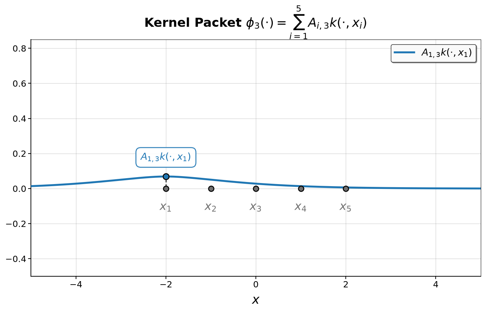
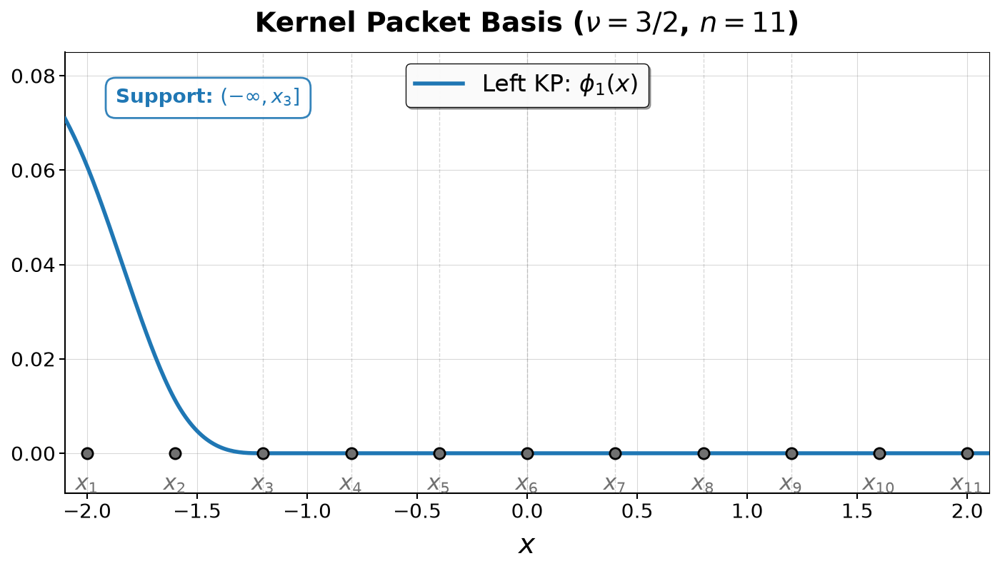
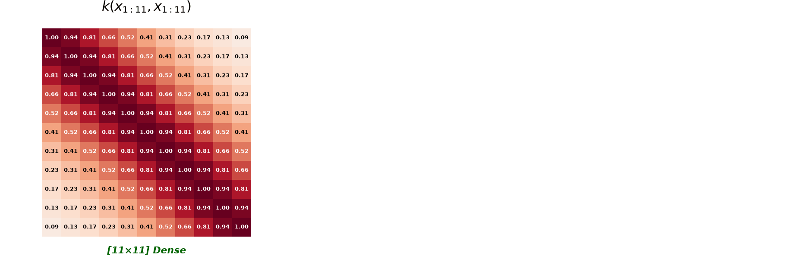
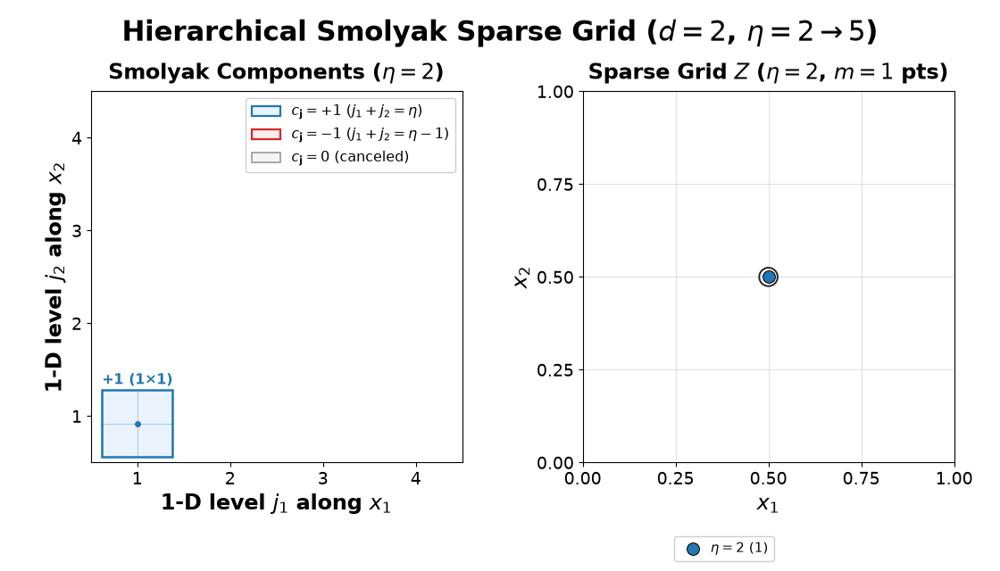

# Kernel Packets

[](https://github.com/hchen19/kernel_packet/actions/workflows/ci.yml)


[Gaussian process](https://en.wikipedia.org/wiki/Gaussian_process) regression and sampling with [Matérn-ν](https://en.wikipedia.org/wiki/Mat%C3%A9rn_covariance_function) kernels ($`\nu = \frac{1}{2}, \frac{3}{2}, \frac{5}{2}, \dots`$; packet size $`k = 2\nu + 2 = 3, 5, 7, \dots`$) by kernel packets (KP):
**exact in $`O(n)`$ time and memory in 1-D**, and **sparse grids as inducing points in $`d`$ dimensions**. One C++ core does
all the kernel-packet work and runs on its own ([C++](cpp/)); [Python](python/) (NumPy, JAX, or PyTorch, CPU or GPU),
[MATLAB](matlab/) and [Julia](julia/) call it through the same C API ([`cpp/include/c_api.hpp`](cpp/include/c_api.hpp)):
Python by `ctypes` and Julia by `ccall` into `build/libkernel_packets.so`, MATLAB by the MEX gateway `build/kp_mex`
compiled from the same sources. On a GPU, [CUDA](https://en.wikipedia.org/wiki/CUDA) kernels of the same operations ([`cpp/cuda/`](cpp/cuda/)) work on the
arrays where they are (Python: torch CUDA tensors and JAX GPU arrays, without copies to the host).

| Language | Version | Pinned in |
|---|---|---|
| C++ | C++20, g++ 14.1.0; nvcc 12.8.61 for the GPU build (optional) | [`cpp/toolchain.txt`](cpp/toolchain.txt) |
| Python | 3.14.0 (uv 0.13.4): NumPy 2.5.5, SciPy 1.18.1, Matplotlib 3.11.2; optional JAX 0.12.0.1, PyTorch 2.14.1 | [`python/.python-version`](python/.python-version), [`python/uv.lock`](python/uv.lock) |
| MATLAB | R2023b or newer, no toolbox (CI: R2026b) | [`matlab/resources/mpackage.json`](matlab/resources/mpackage.json) |
| Julia | 1.12.0: Plots 1.41.9 and the standard library | [`julia/Manifest.toml`](julia/Manifest.toml) |

`scripts/setup_env.sh <language>` installs these versions inside the repository (g++, Python, Julia and their packages);
MATLAB and nvcc are the installed or module-loaded ones ([Setup](#setup)).

## Contents

- [Method](#method)
  - [Theory](#theory)
  - [One dimension: exact kernel packets](#one-dimension-exact-kernel-packets)
  - [d dimensions: sparse grids as inducing points](#d-dimensions-sparse-grids-as-inducing-points)
- [Layout](#layout)
  - [Folders](#folders)
  - [Modules across languages](#modules-across-languages)
  - [Where computation runs](#where-computation-runs)
- [Scripts](#scripts)
  - [Workflow](#workflow)
  - [setup_env.sh: environments and builds](#setup_envsh-environments-and-builds)
  - [run_regression.sh and run_sampling.sh: experiments](#run_regressionsh-and-run_samplingsh-experiments)
  - [On a cluster](#on-a-cluster)
  - [Environment variables](#environment-variables)
- [Setup](#setup)
  - [C++ toolchain](#c-toolchain)
  - [C++](#c-setup)
  - [Python](#python-setup)
  - [MATLAB](#matlab-setup)
  - [Julia](#julia-setup)
- [Usage](#usage)
  - [C++](#c)
  - [Python](#python)
  - [MATLAB](#matlab)
  - [Julia](#julia)
- [Tests](#tests)
- [Experiments](#experiments)
  - [Regression: toy](#regression-toy)
  - [Sampling: synthetic](#sampling-synthetic)
  - [Outputs](#outputs)
- [Numerics and limits](#numerics-and-limits)
- [References](#references)

## Method

### Theory

A standard [Gaussian process](https://en.wikipedia.org/wiki/Gaussian_process) (GP) with a [Matérn-ν kernel](https://en.wikipedia.org/wiki/Mat%C3%A9rn_covariance_function) has a dense $`n \times n`$ [covariance matrix](https://en.wikipedia.org/wiki/Covariance_matrix) $`K`$, which takes $`O(n^3)`$ time and $`O(n^2)`$ memory to factor and invert. **Kernel Packets (KPs)** solve this **exactly in 1-D** in $`O(n)`$ time and memory: just as [finite differences](https://en.wikipedia.org/wiki/Finite_difference) of neighboring values cancel polynomials, a specific weighted sum of $`k = 2\nu + 2`$ neighboring Matérn-ν kernels cancels their exponential tails outside a local interval, turning the dense matrix $`K`$ into two [banded matrices](https://en.wikipedia.org/wiki/Band_matrix).

#### 1. Constructing a Kernel Packet

For any half-integer smoothness $`\nu \in \lbrace \frac{1}{2}, \frac{3}{2}, \frac{5}{2}, \dots\rbrace`$, define the packet size $`k = 2\nu + 2`$ (so $`k = 5`$ for Matérn-3/2). Combining $`k`$ consecutive kernels around $`x_j`$ with coefficients $`A_{\cdot, j}`$ makes every exponential tail cancel out identically outside the local window $`[x_{j - \frac{k-1}{2}},  x_{j + \frac{k-1}{2}}]`$:

```math
\phi_j(x) = \sum_{i = j - \frac{k-1}{2}}^{j + \frac{k-1}{2}} A_{i, j}\thinspace k(x, x_i), \qquad k = 2\nu + 2
```

For $`\nu = \frac{3}{2}`$ ($`k = 5`$), each packet uses only two neighbors on each side: outside $`[x_{j-2}, x_{j+2}]`$, $`\phi_j(x) \equiv 0`$. Five wide, overlapping curves combine into a single compactly supported bump:

<p align="center"></p>

#### 2. Kernel Packet basis

Repeating this local combination across sorted nodes $`x_1 < \dots < x_n`$ yields $`n`$ basis functions: $`\nu + \frac{1}{2}`$ left-sided boundary packets (blue), $`n - 2\nu - 1`$ compactly supported intermediate packets (red), and $`\nu + \frac{1}{2}`$ right-sided boundary packets (green). They span the exact same function space as $`\lbrace k(\cdot, x_i)\rbrace _{i=1}^n`$, while at any point $`x`$ at most $`k - 1 = 2\nu + 1`$ packets are nonzero:

<p align="center"></p>

#### 3. Banded linear algebra

Writing all $`n`$ local combinations in matrix form transforms the dense kernel matrix $`K`$ into two sparse **banded** matrices $`A`$ (half-bandwidth $`\nu + \frac{1}{2}`$) and $`\Phi`$ (half-bandwidth $`\nu - \frac{1}{2}`$):

```math
K A = \Phi, \qquad K_{i,j} = k(x_i, x_j), \qquad \Phi_{i,j} = \phi_j(x_i)
```

Because factoring and solving banded systems takes $`O(n)`$ time and memory, exact GP inversion, log-determinants, and sampling follow immediately:

```math
K^{-1} = A \Phi^{-1}, \qquad \log\lvert K \rvert = \log\lvert \Phi \rvert - \log\lvert A \rvert, \qquad K = \Phi B^{-1}\Phi^\top \quad (B = A^\top \Phi)
```

<p align="center"></p>

Regenerate the demo animations with `python/.venv/bin/python demo/demo.py` ([`demo/demo.py`](demo/demo.py)).

### One dimension: exact kernel packets

On sorted nodes, each KP is a compactly supported combination of $`k = 2\nu + 2`$ Matérn-ν kernel functions ($`\nu \in \lbrace \frac{1}{2}, \frac{3}{2}, \frac{5}{2}, \dots\rbrace`$). Two methods, chosen by the `method` argument:

**`stable` (default, Matérn-ν for $`\nu \in \lbrace \frac{1}{2}, \frac{3}{2}, \frac{5}{2}\rbrace`$, noise ratio $`\tau^2`$)**: implemented in
[`cpp/include/stable/`](cpp/include/stable/).

- On dense nodes ($`c h \le 1`$ with mean spacing $`h`$, and $`\tau^2 \le 0.1 (c h)^{2\nu}`$), the factored one-sided whitening
  $`K + \tau^2 I = \tilde{C}^{-1} G \tilde{C}^{-\top}`$ applies. $`\tilde{C}`$ is a product of $`\nu + \frac{1}{2}`$ bidiagonal stages and $`G = \tilde{B} + \tau^2 \tilde{C}\tilde{C}^\top`$ is banded, so
  $`\alpha = \tilde{C}^\top G^{-1} \tilde{C} y`$ is computed without forming the ill-conditioned $`K`$.
- Otherwise, the two-sided KPs of $`\Phi_\tau = \Phi + \tau^2 A`$ are used in block [LU](https://en.wikipedia.org/wiki/LU_decomposition).
- On noisy dense data ($`\tau^2 > 0.03 (c h)^{2\nu}`$), the square-root [state-space](https://en.wikipedia.org/wiki/State-space_representation) [Kalman filter](https://en.wikipedia.org/wiki/Kalman_filter) and [RTS smoother](https://en.wikipedia.org/wiki/Kalman_filter#Rauch%E2%80%93Tung%E2%80%93Striebel) on the factored
  one-sided KP state keep every term to rounding.
- The posterior mean takes the Green form at the window of each test point. The variance is $`O(1)`$ per point from a
  selected inverse or the smoothed covariance band.
- The likelihood comes from [Givens rotations](https://en.wikipedia.org/wiki/Givens_rotation) of the stacked rows $`[L_B^\top; \tau C^\top]`$ or the filter innovations.
- Prior draws are $`\tilde{C}^{-1} L_B \epsilon`$; posterior draws use Matheron's rule on the union of the nodes and the test points, with $`\epsilon \sim \mathcal{N}(0, I)`$.

The result stays exact to rounding when $`K`$ is far beyond $`1/\varepsilon`$ ([machine epsilon](https://en.wikipedia.org/wiki/Machine_epsilon)): clustered nodes, smooth kernels, large $`n`$.

**`original` (noise-free, any half-integer $`\nu = \frac{k-2}{2}`$)**: the coefficient matrix $`A`$ and $`\Phi = K A`$ are banded, so

- $`K^{-1} = A \Phi^{-1}`$ and $`\log\lvert K \rvert = \log\lvert \Phi \rvert - \log\lvert A \rvert`$ (posterior mean, variance, likelihood in $`O(n)`$);
- with $`B = A^\top \Phi`$ (banded, positive definite), $`K = \Phi B^{-1} \Phi^\top`$, and $`\Phi L^{-\top} \epsilon \sim \mathcal{N}(0, K)`$ for $`B = L L^\top`$ and $`\epsilon \sim \mathcal{N}(0, I)`$ (prior draws in $`O(n)`$);
  posterior draws condition prior draws on the data (Matheron's rule).

Its accuracy is limited by the [condition numbers](https://en.wikipedia.org/wiki/Condition_number) $`\mathrm{cond}(B)`$ and $`\mathrm{cond}(\Phi)`$ (see [Numerics and limits](#numerics-and-limits)). It is also taken for
$`\nu > \frac{5}{2}`$ ($`k > 7`$) and for $`n < k`$. The sparse grids use the original 1-D KPs along each axis.

### d dimensions: sparse grids as inducing points

In $`d`$ dimensions, placing a full tensor grid of $`n_1`$ points per axis requires $`n_1^d`$ points, which grows exponentially with $`d`$. Instead, we choose inducing points $`Z = \lbrace z_1, \dots, z_{n_Z}\rbrace  \subset [0, 1]^d`$ ($`n_Z = \lvert Z \rvert \ll n`$) from a **[Smolyak sparse grid](https://en.wikipedia.org/wiki/Sparse_grid)** of level $`\eta \ge d`$ built out of nested 1-D designs $`\mathcal{X}_1 \subset \mathcal{X}_2 \subset \dots \subset \mathcal{X}_{\eta - d + 1}`$ (e.g., hyperbolic-cross `hc` or Plumlee `pl` points). As $`\eta`$ increases ($`\eta = 2 \to 3 \to 4 \to 5`$), points are added **hierarchically** while the Smolyak formula combines only the outer thin tensor grids $`G_{\mathbf{j}} = \mathcal{X}_{j_1} \times \dots \times \mathcal{X}_{j_d}`$ with $`\max(d, \eta - d + 1) \le \lvert \mathbf{j} \rvert_1 \le \eta`$ ($`c_{\mathbf{j}} = +1`$ along the frontier, $`c_{\mathbf{j}} = -1`$ along the overlap diagonal, and $`c_{\mathbf{j}} = 0`$ on all interior levels):

<p align="center"></p>

**Why $`K_{ZZ}^{-1}`$ and $`\log\lvert K_{ZZ} \rvert`$ are fast.** Because the $`d`$-D Matérn kernel $`k(x, x') = \sigma^2 \prod_{r=1}^d k_r(x_r, x'_r)`$ is a product over coordinates, the inducing covariance matrix on each tensor component $`G_{\mathbf{j}}`$ is a [Kronecker product](https://en.wikipedia.org/wiki/Kronecker_product) $`K_{G_{\mathbf{j}}} = K^{(1)}_{j_1} \otimes \dots \otimes K^{(d)}_{j_d}`$ (absorbing $`\sigma^{2/d}`$ per axis). Its inverse runs in $`O(\lvert G_{\mathbf{j}} \rvert)`$ time by applying independent 1-D KP solves along each coordinate fiber, and the Smolyak **combination technique** assembles the exact sparse-grid inverse and log-determinant without ever forming $`K_{ZZ}^{-1}`$ densely:

```math
K_{ZZ}^{-1} Y = \sum_{\max(d, \eta - d + 1) \le \lvert \mathbf{j} \rvert_1 \le \eta} c_{\mathbf{j}}\thinspace P_{\mathbf{j}}^\top \left(K^{(1)}_{j_1} \otimes \dots \otimes K^{(d)}_{j_d}\right)^{-1} P_{\mathbf{j}} Y, \qquad c_{\mathbf{j}} = (-1)^{\eta - \lvert \mathbf{j} \rvert_1}\binom{d - 1}{\eta - \lvert \mathbf{j} \rvert_1}
```

```math
\log\lvert K_{ZZ} \rvert = \sum_{d \le \lvert \mathbf{j} \rvert_1 \le \eta} \sum_{r=1}^{d} \left(\log\lvert K^{(r)}_{j_r} \rvert - \log\lvert K^{(r)}_{j_r - 1} \rvert\right) \prod_{l \neq r} \left(\lvert \mathcal{X}_{j_l} \rvert - \lvert \mathcal{X}_{j_l - 1} \rvert\right)
```

where $`P_{\mathbf{j}}`$ restricts $`Z`$ onto component $`G_{\mathbf{j}}`$ and $`\lvert \mathcal{X}_0 \rvert = \log\lvert K^{(r)}_0 \rvert = 0`$.

**Variational GP algorithm for scattered data $`(X, y)`$.** Following Titsias (2009) with inducing points $`Z`$ ($`n_Z = \lvert Z \rvert`$), [Nyström approximation](https://en.wikipedia.org/wiki/Low-rank_matrix_approximations#Nystr%C3%B6m_approximation) $`Q_{XX} = K_{XZ} K_{ZZ}^{-1} K_{ZX}`$, and noise variance $`\tau^2`$:

**1. Chunked sufficient statistics** ($`O(n_Z^2)`$ memory, never storing the $`n \times n_Z`$ matrix $`K_{XZ}`$):

```math
G = K_{ZX} K_{XZ} = \sum_{b} K_{Z, X_b} K_{X_b, Z}, \qquad b_y = K_{ZX} y = \sum_{b} K_{Z, X_b} y_b
```

**2. [Cholesky factor](https://en.wikipedia.org/wiki/Cholesky_decomposition) and weights** (on the $`n_Z \times n_Z`$ matrix $`\Sigma`$):

```math
\Sigma = K_{ZZ} + \frac{1}{\tau^2} G = L L^\top, \qquad \alpha = \frac{1}{\tau^2} L^{-\top} L^{-1} b_y
```

**3. Variational lower bound ([ELBO](https://en.wikipedia.org/wiki/Evidence_lower_bound))** maximized over $`(\rho, \sigma^2, \tau^2)`$, using $`\mathrm{tr}(K_{XX} - Q_{XX}) = n\sigma^2 - \mathrm{tr}(K_{ZZ}^{-1} G)`$ evaluated column-by-column via KP solves in $`O(n_Z)`$ memory per thread:

```math
\mathcal{L} = -\frac{1}{2}\left[\frac{y^\top y - b_y^\top \alpha}{\tau^2} + 2\sum_{i=1}^{n_Z}\log L_{ii} - \log\lvert K_{ZZ} \rvert + n\log(2\pi\tau^2)\right] - \frac{1}{2\tau^2}\left(n\sigma^2 - \mathrm{tr}\left(K_{ZZ}^{-1} G\right)\right)
```

**4. Prediction and posterior sampling** at test points $`x_{\ast}`$ (with $`k_{\ast} = k(Z, x_{\ast})`$ and $`\epsilon \sim \mathcal{N}(0, I_{n_Z})`$):

```math
\mu(x_{\ast}) = k_{\ast}^\top \alpha, \qquad v(x_{\ast}) = k(x_{\ast}, x_{\ast}) - k_{\ast}^\top K_{ZZ}^{-1} k_{\ast} + \lVert L^{-1} k_{\ast} \rVert_2^2, \qquad f_{\ast} = \mu(x_{\ast}) + k_{\ast}^\top L^{-\top} \epsilon
```

## Layout

### Folders

One folder per language with the same structure, around a shared C++ core:

| Path | Contents |
|---|---|
| [`cpp/`](cpp/) | C++ core: [`kernel_packets.cpp`](cpp/kernel_packets.cpp), [`regression.cpp`](cpp/regression.cpp), [`sampling.cpp`](cpp/sampling.cpp), [`sparse_grid.cpp`](cpp/sparse_grid.cpp), [`likelihood.cpp`](cpp/likelihood.cpp); compiled into `build/` |
| [`cpp/cuda/`](cpp/cuda/) | the CUDA kernels: [`sparse_grid.cu`](cpp/cuda/sparse_grid.cu) (sparse-grid solve and trace), [`regression.cu`](cpp/cuda/regression.cu) (kernel sums); compiled into `build/libkernel_packets_cuda.so` |
| [`cpp/toolchain.txt`](cpp/toolchain.txt) | the pinned compilers (g++ 14.1.0, nvcc 12.8.61) and flags of every build |
| [`cpp/tests/`](cpp/tests/), [`cpp/examples/`](cpp/examples/) | [`test_kernel_packets.cpp`](cpp/tests/test_kernel_packets.cpp); [`regression.cpp`](cpp/examples/regression.cpp), [`sampling.cpp`](cpp/examples/sampling.cpp): C++ alone |
| [`cpp/include/`](cpp/include/) | [`c_api.hpp`](cpp/include/c_api.hpp) (the C API), [`common.hpp`](cpp/include/common.hpp), [`kp_model.hpp`](cpp/include/kp_model.hpp) (the handle of both), [`sparse_grid.hpp`](cpp/include/sparse_grid.hpp), [`original/`](cpp/include/original/), [`stable/`](cpp/include/stable/) |
| [`cpp/include/original/`](cpp/include/original/) | the original KPs: [`kernel_packets.hpp`](cpp/include/original/kernel_packets.hpp), [`banded_linalg.hpp`](cpp/include/original/banded_linalg.hpp) |
| [`cpp/include/stable/`](cpp/include/stable/) | the stable KPs: [`stable_kp.hpp`](cpp/include/stable/stable_kp.hpp), [`kernel_packets.hpp`](cpp/include/stable/kernel_packets.hpp), [`regression.hpp`](cpp/include/stable/regression.hpp), [`sampling.hpp`](cpp/include/stable/sampling.hpp), [`likelihood.hpp`](cpp/include/stable/likelihood.hpp), [`smoother.hpp`](cpp/include/stable/smoother.hpp), [`banded_linalg.hpp`](cpp/include/stable/banded_linalg.hpp), [`common.hpp`](cpp/include/stable/common.hpp), [`gauss_rules.hpp`](cpp/include/stable/gauss_rules.hpp) |
| [`python/`](python/) | [`pyproject.toml`](python/pyproject.toml), [`uv.lock`](python/uv.lock), [`.python-version`](python/.python-version), `.venv/` |
| [`python/src/kernel_packets/`](python/src/kernel_packets/) | the methods |
| [`python/src/benchmarks/`](python/src/benchmarks/) | [`dense_gp.py`](python/src/benchmarks/dense_gp.py): the exact GP by Cholesky |
| [`python/src/evaluation/`](python/src/evaluation/) | [`arrays.py`](python/src/evaluation/arrays.py), [`metrics.py`](python/src/evaluation/metrics.py), [`plotting.py`](python/src/evaluation/plotting.py) |
| [`python/experiments/`](python/experiments/) | [`regression/toy/`](python/experiments/regression/toy/), [`sampling/synthetic/`](python/experiments/sampling/synthetic/): `data`, `main`, `results/` |
| [`python/tests/`](python/tests/) | [`test_kernel_packets.py`](python/tests/test_kernel_packets.py) |
| [`matlab/`](matlab/) | the same tree, one `.m` file per function (a Python module is a folder); [`resources/mpackage.json`](matlab/resources/mpackage.json), [`buildfile.m`](matlab/buildfile.m) |
| [`julia/`](julia/) | the same tree; [`Project.toml`](julia/Project.toml), [`Manifest.toml`](julia/Manifest.toml), [`deps/build.jl`](julia/deps/build.jl); [`src/KernelPackets.jl`](julia/src/KernelPackets.jl) includes `src/kernel_packets/*.jl` (`Plots` + stdlibs, pure-Julia [`optimize.jl`](julia/src/kernel_packets/optimize.jl)) |
| [`scripts/`](scripts/) | [`setup_env.sh`](scripts/setup_env.sh), [`run_regression.sh`](scripts/run_regression.sh), [`run_sampling.sh`](scripts/run_sampling.sh) ([Scripts](#scripts)) |
| [`demo/`](demo/) | [`demo.py`](demo/demo.py) and [`figures/`](demo/figures/): animated GIFs of the 1-D KP construction, basis, banded factorization, and 2-D Smolyak sparse grid |

### Modules across languages

| Python [`src/kernel_packets/`](python/src/kernel_packets/) | MATLAB [`src/kernel_packets/`](matlab/src/kernel_packets/) | Julia [`src/kernel_packets/`](julia/src/kernel_packets/) | C++ [`cpp/`](cpp/) |
|---|---|---|---|
| [`backend.py`](python/src/kernel_packets/backend.py) | [`backend/`](matlab/src/kernel_packets/backend/) | [`backend.jl`](julia/src/kernel_packets/backend.jl) | [`c_api.hpp`](cpp/include/c_api.hpp) |
| [`kernel_packets.py`](python/src/kernel_packets/kernel_packets.py) | [`kernel_packets/`](matlab/src/kernel_packets/kernel_packets/) | [`kernel_packets.jl`](julia/src/kernel_packets/kernel_packets.jl) | [`kernel_packets.cpp`](cpp/kernel_packets.cpp) |
| [`regression.py`](python/src/kernel_packets/regression.py) | [`regression/`](matlab/src/kernel_packets/regression/) | [`regression.jl`](julia/src/kernel_packets/regression.jl) | [`regression.cpp`](cpp/regression.cpp) |
| [`sampling.py`](python/src/kernel_packets/sampling.py) | [`sampling/`](matlab/src/kernel_packets/sampling/) | [`sampling.jl`](julia/src/kernel_packets/sampling.jl) | [`sampling.cpp`](cpp/sampling.cpp) |
| [`sparse_grid.py`](python/src/kernel_packets/sparse_grid.py) | [`sparse_grid/`](matlab/src/kernel_packets/sparse_grid/) | [`sparse_grid.jl`](julia/src/kernel_packets/sparse_grid.jl) | [`sparse_grid.cpp`](cpp/sparse_grid.cpp) |
| [`likelihood.py`](python/src/kernel_packets/likelihood.py) | [`likelihood/`](matlab/src/kernel_packets/likelihood/) | [`likelihood.jl`](julia/src/kernel_packets/likelihood.jl) | [`likelihood.cpp`](cpp/likelihood.cpp) |

### Where computation runs

**In C++, on host threads**: the stable KPs (factored whitening, block LU, Green-form mean, selected-inverse variance,
Givens likelihood, samplers), the original KP coefficients ([Householder QR](https://en.wikipedia.org/wiki/Householder_transformation) null vectors, in a Taylor-normalized moment basis for
close nodes), banded LU / Cholesky and solves, the KP basis at new points, the 1-D posterior mean / variance /
covariance ($`O(n)`$ memory per thread), prior and posterior draws, the sparse-grid design and combination-technique
solve, log-determinants, profile likelihoods, and kernel sums $`K(x, X) w`$ evaluated on the fly.

**In CUDA, on the GPU** ([`cpp/cuda/`](cpp/cuda/)), for arrays on a GPU: the sparse-grid solve and trace (one
thread per 1-D fiber, one launch per axis; equal to the CPU results to the bit) and kernel sums. The device follows the
data: GPU arrays stay on the GPU, host arrays on the CPU.

**In the language, [BLAS](https://en.wikipedia.org/wiki/Basic_Linear_Algebra_Subprograms)-3 on the CPU or GPU**: the dense $`n_Z \times n_Z`$ products and Cholesky factor of the sparse-grid
regression (NumPy, JAX, or PyTorch on the data's device in Python, [LAPACK](https://en.wikipedia.org/wiki/LAPACK) in MATLAB and Julia), and the exact-GP benchmark.

## Scripts

### Workflow

All scripts are run from anywhere (they move to the repository root), in this order:

1. **Set up** the language once (and after a change of a lock file): `scripts/setup_env.sh <language>`.
2. **Run** experiments: `scripts/run_regression.sh <language> <dataset> [parts] [replot] [name=value]`,
   `scripts/run_sampling.sh <language> <setting> [parts] [replot] [name=value]`.

On a cluster, the same two commands are submitted as jobs ([On a cluster](#on-a-cluster)).

```bash
scripts/setup_env.sh python                                   # 1. once
scripts/run_regression.sh python toy                          # 2. every part of the toy regression
scripts/run_sampling.sh python synthetic prior_scaling        #    one part of the synthetic sampling
scripts/run_regression.sh python toy sparse_grid rho=0.5 tau2=1e-3   # fixed instead of trained hyperparameters
scripts/run_regression.sh python toy replot                   # the figures again from the saved results
```

### setup_env.sh: environments and builds

```bash
scripts/setup_env.sh <cpp|python|matlab|julia|all|cleanup> [--jax|--torch|--numpy|--all] [--cpu]
```

| Argument | What it does |
|---|---|
| `cpp` | builds the C++ core `build/libkernel_packets.so`, the tests and examples, and runs the tests (C++ alone) |
| `python` | creates `python/.venv` with the exact versions of `python/uv.lock` and builds the C++ core; `--jax`: JAX only, `--torch`: PyTorch only, `--numpy`: NumPy/SciPy core only, `--all` (default): both; `--cpu`: JAX without CUDA wheels |
| `matlab` | loads MATLAB (PATH or `module load matlab`), builds `build/kp_mex` and runs the MATLAB tests |
| `julia` | installs Julia and the packages into `.julia/` (pinned by `julia/Manifest.toml`), builds the C++ core |
| `all` | `cpp`, `python`, `matlab`, `julia` in turn; a language that fails is reported and the others continue |
| `cleanup` | removes `build/`, caches and `__pycache__` |

Sourced (`source scripts/setup_env.sh`) it only sets the run-time environment (repository root, threads, devices,
caches; [Environment variables](#environment-variables)); the run scripts source it this way.

### run_regression.sh and run_sampling.sh: experiments

```bash
scripts/run_regression.sh <language> <dataset> [parts] [replot] [name=value]
scripts/run_sampling.sh   <language> <setting> [parts] [replot] [name=value]
```

| Position | Argument | Values |
|---|---|---|
| 1 | language | `python`, `matlab`, `julia`, or `all` (the three in turn) |
| 2 | dataset / setting | `toy` (regression), `synthetic` (sampling): a folder of `<language>/experiments/regression/` or `<language>/experiments/sampling/` |
| 3… | parts (optional) | regression: `posterior_1d`, `accuracy_1d`, `scaling_1d`, `sparse_grid`, `scaling_nd`; sampling: `prior_draws`, `prior_accuracy`, `prior_sensitivity`, `prior_scaling`, `posterior_draws`, `posterior_accuracy`, `posterior_sensitivity`, `scaling_1d`, `posterior_sparse_grid`; none: every part |
| any | `name=value` (optional) | fixed hyperparameters for both methods, e.g. `rho=0.5 sigma2=1 tau2=1e-3`; none: trained (below). `method=original`: the original 1-D KPs instead of the stable ones (results in `results/original/`). Python also accepts `framework=jax\|torch\|numpy` or `--jax` / `--torch` / `--numpy` (overriding `KP_FRAMEWORK`) |
| any | `replot` (optional) | only the figures of the parts, again from the saved results (`metrics.csv` and saved curve files): no training or evaluation |

They run `<language>/experiments/<task>/<dataset>/main.{py,m,jl}` with the parts and write into its `results/`: the
table `metrics.csv` (rows of the parts that ran are replaced, others kept), the figures, and the log `log.txt`
(`log_<parts>.txt` when parts are named; `_gpu` appended on a GPU node). What each part computes:
[Regression: toy](#regression-toy), [Sampling: synthetic](#sampling-synthetic).

### On a cluster

The scripts need no scheduler-specific change: under Slurm, PBS, Grid Engine or LSF they find the repository root
(the submission directory) and use the job's CPUs ([Environment variables](#environment-variables)). Submit them from
the repository root with the scheduler's own command, for example 8 CPUs, 32 GB, 12 hours (add a GPU on a GPU queue):

| Scheduler | Command |
|---|---|
| Slurm | `sbatch -c 8 --mem=32G -t 12:00:00 [--gres=gpu:1] --wrap "scripts/run_regression.sh python toy"` |
| PBS Pro / OpenPBS | `qsub -l select=1:ncpus=8:mem=32gb[:ngpus=1] -l walltime=12:00:00 -- scripts/run_regression.sh python toy` |
| Grid Engine | `qsub -cwd -V -pe smp 8 -l h_rt=12:00:00 -b y scripts/run_regression.sh python toy` |
| LSF | `bsub -n 8 -R "span[hosts=1] rusage[mem=32GB]" -W 12:00 scripts/run_regression.sh python toy` |

### Environment variables

Set by `setup_env.sh` (sourced by every run), from the job's resources (with or without a scheduler):

| Variable | Value | Effect |
|---|---|---|
| `KP_NUM_THREADS` | the job's CPUs: Slurm `SLURM_CPUS_PER_TASK`, PBS `NCPUS`, LSF `LSB_DJOB_NUMPROC`, Grid Engine `NSLOTS`, else `nproc` | threads of the C++ core |
| `OMP_NUM_THREADS`, `MKL_NUM_THREADS`, `OPENBLAS_NUM_THREADS`, `JULIA_NUM_THREADS` | `KP_NUM_THREADS` | BLAS, OpenMP and Julia threads (no oversubscription of the job's CPUs); MATLAB gets `maxNumCompThreads` |
| `KP_FRAMEWORK` | unset (auto-detects installed `jax`, `torch`, or `numpy`), or `jax`, `torch`, `numpy` | default Python experiment array framework (overridable per run via `framework=...` or `--jax`/`--torch`/`--numpy`) |
| `JAX_PLATFORMS` | `cpu` when no GPU is visible | JAX on the CPU; torch, C++, MATLAB, Julia follow the arrays' device |
| `XLA_PYTHON_CLIENT_PREALLOCATE`, `PYTORCH_CUDA_ALLOC_CONF` | `false`, `expandable_segments:True` | GPU memory on demand (JAX, torch) |
| `JAX_COMPILATION_CACHE_DIR` | `python/.jax_cache` | compiled XLA programs kept between runs |
| `JULIA_PROJECT`, `JULIA_DEPOT_PATH` | `julia/`, `.julia/depot` | the Julia environment inside the repository |
| `KP_ALLOW_ANY_CXX` | unset (or `1` on CI / external containers) | skips the exact `g++` version check in `cpp/toolchain.txt` when building on another host compiler |

## Setup

[`scripts/setup_env.sh`](scripts/setup_env.sh) sets up one language (or `all`) and builds the C++ core it calls.
Pinned for exact reproduction: C++ ([`cpp/toolchain.txt`](cpp/toolchain.txt)), Python (every wheel by hash in
`uv.lock`), Julia (the binary version and `Manifest.toml`); MATLAB is licensed software, loaded and checked for release
R2023b or newer (no toolbox needed).

### C++ toolchain

[`cpp/toolchain.txt`](cpp/toolchain.txt) pins the compiler versions (g++ 14.1.0, nvcc 12.8.61), the standard
(C++20), the CPU target (`-march=x86-64-v3`: AVX2 and FMA, not the machine's own `-march=native`, whose instruction set
varies between nodes), the GPU targets (V100, A100, H100 and newer through PTX) and no fused multiply-add contraction
(`-ffp-contract=off`, nvcc `--fmad=false`), so results do not depend on how a loop is compiled and the CPU and GPU
sparse-grid solves agree to the bit. Every build (Python, Julia, MATLAB, C++ alone) reads it and stops on another
compiler version, so every machine builds the same binary; the threads split independent work (no reductions across
threads), so results do not depend on their number either. When the system `g++` has another version,
`scripts/setup_env.sh` installs g++ 14.1.0 from conda-forge into `.gcc/` (no system or profile changes), and every build
takes it from there. g++ 14 is the newest that nvcc 12.8 accepts as host compiler, and CUDA 12 is the last to compile for
V100. nvcc is the system's: on the PATH, in `CUDA_HOME`, or the `cuda/12.8` module.

### C++ setup

```bash
scripts/setup_env.sh cpp
```

Builds `build/libkernel_packets.so`, the tests `build/test_kernel_packets` (and runs them) and the examples
`build/example_regression`, `build/example_sampling`.

### Python setup

```bash
scripts/setup_env.sh python [--jax|--torch|--numpy|--all] [--cpu]   # or: scripts/setup_env.sh all
```

- `--jax`: installs only JAX modules (`[jax]`, plus `[cuda]` JAX CUDA 12 wheels on Linux x86-64 unless `--cpu` is passed).
- `--torch`: installs only PyTorch modules (`[torch]`, torch 2.14.1 with CUDA 12.6 on Linux x86-64, which still supports V100 GPUs).
- `--numpy`: installs only the core `numpy` / `scipy` / `matplotlib` packages without JAX or PyTorch.
- `--all` (default): installs both `[jax]` and `[torch]` (plus `[cuda]` on Linux x86-64 unless `--cpu` is passed).

All variants use uv 0.13.4, Python 3.14.0 ([`python/.python-version`](python/.python-version)), and exact hashes from
[`python/uv.lock`](python/uv.lock) into `python/.venv`.

### MATLAB setup

```bash
scripts/setup_env.sh matlab
```

MATLAB ≥ R2023b, no toolbox ([`matlab/resources/mpackage.json`](matlab/resources/mpackage.json)); builds
`build/kp_mex` and runs the tests through [`matlab/buildfile.m`](matlab/buildfile.m) (`buildtool mex`, `buildtool test`).

### Julia setup

```bash
scripts/setup_env.sh julia
```

The official Julia binary and the package depot inside `.julia/` (no system or profile changes); the packages of
[`julia/Project.toml`](julia/Project.toml) at the versions of [`julia/Manifest.toml`](julia/Manifest.toml);
`build/libkernel_packets.so` through [`julia/deps/build.jl`](julia/deps/build.jl).

## Usage

### C++

```cpp
#include "c_api.hpp"          // compile with the flags of cpp/toolchain.txt: -Icpp/include cpp/*.cpp

std::vector<double> x = ..., y = ..., xs = ..., mean(xs.size()), var(xs.size());
void* h = kp_new(x.data(), x.size(), 5, 0.1, 0.0, 0);   // Matern-3/2 on sorted x, tau2 = 0, stable (1: original)
kp_posterior(h, xs.data(), xs.size(), y.data(), mean.data(), var.data());
kp_free(h);
```

The classes `kp::StableKP` ([`stable_kp.hpp`](cpp/include/stable/stable_kp.hpp)), `kp::KernelPacket`
([`kernel_packets.hpp`](cpp/include/original/kernel_packets.hpp)) and `kp::SparseGrid`
([`sparse_grid.hpp`](cpp/include/sparse_grid.hpp)) can be used directly; see [`cpp/examples/`](cpp/examples/).

### Python

```python
import numpy as np
import kernel_packets as kp

x = np.linspace(0, 1, 10**6); y = np.sin(8 * x)
m = kp.KernelPacket(x, k=5, rho=0.1)                           # Matérn-3/2, exact, O(n), stable KPs
m_noisy = kp.KernelPacket(x, 5, 0.1, tau2=1e-4)                # noise ratio tau2 (stable)
m_orig = kp.KernelPacket(x, 5, 0.1, method="original")         # the original KPs
mean, var = kp.posterior(m, np.random.rand(500), y, var=True)
draws = kp.posterior_sample(m, np.linspace(0, 1, 200), y, p=16)
theta, L_hat, L_init = kp.mle(m, y)                            # maximum likelihood lengthscale

X = np.random.rand(5000, 4); yd = np.cos(X @ [3.0, 2, 1, 0.5])
sg = kp.SparseGrid(d=4, eta=8, k=5, rho=0.5)                   # inducing points
model = kp.SparseGridRegression(X, yd, sg, sigma2=1.0, tau2=1e-3).train()
mean, var = model.predict(np.random.rand(1000, 4), var=True)   # NumPy / JAX arrays or torch tensors (CPU or CUDA)
```

### MATLAB

```matlab
addpath(genpath('matlab/src'));
x = linspace(0, 1, 1e6)'; y = sin(8 * x);
m = kernel_packet(x, 5, 0.1);                                  % Matern-3/2, exact, O(n), stable KPs
m_orig = kernel_packet(x, 5, 0.1, 0, 'original');              % tau2 = 0, the original KPs
[mu, v] = posterior(m, rand(500, 1), y);
F = posterior_sample(m, linspace(0, 1, 200)', y, 16);

X = rand(5000, 4); yd = cos(X * [3; 2; 1; 0.5]);
model = sparse_grid_regression(X, yd, sparse_grid(4, 8, 5, 0.5), 1, 1e-3);
model.train();
[mu, v] = model.predict(rand(1000, 4));
```

### Julia

```julia
using KernelPackets

x = collect(range(0, 1, 10^6)); y = sin.(8x)
m = KernelPacket(x, 5, 0.1)                                    # Matérn-3/2, exact, O(n), stable KPs
m_orig = KernelPacket(x, 5, 0.1; method=:original)             # the original KPs
mu, v = posterior(m, rand(500), y; var=true)
F = posterior_sample(m, collect(range(0, 1, 200)), y, 16)

X = rand(5000, 4); yd = cos.(X * [3.0, 2, 1, 0.5])
model = train!(SparseGridRegression(X, yd, SparseGrid(4, 8; k=5, rho=0.5); tau2=1e-3))
mu, v = predict(model, rand(1000, 4); var=true)
```

## Tests

Every language checks the same quantities against dense Gaussian process algebra: backward error of the solves at any
conditioning, log-determinants, posterior mean / variance / covariance, the sparse-grid solve and variational bound,
the implied covariance of the samplers, kernel sums and profile likelihoods.

| Language | Command | Tests |
|---|---|---|
| C++ | `scripts/setup_env.sh cpp` | [`cpp/tests/test_kernel_packets.cpp`](cpp/tests/test_kernel_packets.cpp) |
| Python | `cd python && .venv/bin/python -m pytest` | [`python/tests/test_kernel_packets.py`](python/tests/test_kernel_packets.py) |
| MATLAB | `cd matlab && matlab -batch "buildtool test"` | [`matlab/tests/test_kernel_packets.m`](matlab/tests/test_kernel_packets.m) |
| Julia | `JULIA_DEPOT_PATH=.julia/depot .julia/julia-*/bin/julia --project=julia julia/tests/runtests.jl` | [`julia/tests/runtests.jl`](julia/tests/runtests.jl) |

## Experiments

```bash
scripts/run_regression.sh <python|matlab|julia|all> toy [parts] [replot] [name=value]
scripts/run_sampling.sh <python|matlab|julia|all> synthetic [parts] [replot] [name=value]
```

Arguments, outputs and cluster use: [Scripts](#scripts). Kernel packets (KP) are compared with the exact GP by
Cholesky ([`python/src/benchmarks/dense_gp.py`](python/src/benchmarks/dense_gp.py)), in the framework of the arrays
(`KP_FRAMEWORK=jax`, `torch`, or `numpy`, or `--jax` / `--torch` / `--numpy`) on the GPU when there is one.

**Data**: Gramacy & Lee (2012) in 1-D and Genz oscillatory in $`d`$ dimensions (regression), Griewank
(sampling). Training and test inputs are random and drawn from different distributions: training from two clusters,
leaving a sparse middle region where the posterior widens; test from $`\mathrm{Beta}(0.7, 0.7)`$ ([Beta distribution](https://en.wikipedia.org/wiki/Beta_distribution)). The only structured points are
the sparse grids, as inducing points. Every metric is computed on the test set over $`5`$ random replicates ($`\text{mean} \pm \text{sd}`$).

**Hyperparameters** are trained by default: maximum likelihood for 1-D KP (its likelihood is the exact one, so
Cholesky uses the same values); the variational bound for the sparse-grid model; exact maximum likelihood for the
Cholesky baseline in $`d`$ dimensions. `name=value` arguments fix them for both methods instead.

### Regression: toy

[`data.py`](python/experiments/regression/toy/data.py), [`main.py`](python/experiments/regression/toy/main.py).

| Part | What | Figure |
|---|---|---|
| `posterior_1d` | noise-free data at $`60`$ clustered points: KP and Cholesky means, KP 95% interval, observations, truth | `posterior_1d` |
| `accuracy_1d` | test RMSE, NLPD and [2-Wasserstein distance](https://en.wikipedia.org/wiki/Wasserstein_metric) against $`n = 10^2, 5\cdot 10^2, 10^3, \dots, 5\cdot 10^7, 10^8`$ (Cholesky up to $`10^4`$; $`W_2`$ to the exact posterior `w2_exact` and every other predictive metric in the table) | `accuracy_1d` |
| `scaling_1d` | training time (maximum likelihood of $`\rho`$ and fit) and storage against the training size $`n = 10^2, 5\cdot 10^2, 10^3, \dots, 5\cdot 10^7, 10^8`$ (Cholesky up to $`10^4`$; one replicate above $`10^6`$) | `scaling_1d` |
| `sparse_grid` | noisy scattered data, $`d = 2, 4`$, $`n = 2000`$: test RMSE, NLPD and $`W_2`$ against the number of inducing points $`n_Z`$ (sparse-grid levels, and the automatic level of `SparseGrid.for_data`); time and storage | `accuracy_2d`, `accuracy_4d`, `scaling_sparse_grid_2d`, `scaling_sparse_grid_4d` |
| `scaling_nd` | training time (fit at given hyperparameters, the automatic sparse grid included) and storage against the training size $`n = 10^2 \dots 10^6`$ in $`d = 2, 4`$ (Cholesky up to $`10^4`$) | `scaling_2d`, `scaling_4d` |

### Sampling: synthetic

[`data.py`](python/experiments/sampling/synthetic/data.py), [`main.py`](python/experiments/sampling/synthetic/main.py).

| Part | What | Figure |
|---|---|---|
| `prior_draws` | prior draws of KP and Cholesky at $`500`$ random nodes for Matérn-1/2, 3/2, 5/2 ($`k = 3, 5, 7`$, $`\rho = 0.2`$), prior 95% interval | `prior_draws_1d` |
| `prior_accuracy` | each sampler's implied covariance against $`K`$: 2-Wasserstein distance against $`n = 50 \dots 1000`$, $`k = 3, 5, 7`$ ($`\nu = \frac{1}{2}, \frac{3}{2}, \frac{5}{2}`$) | `prior_accuracy_1d` |
| `prior_sensitivity` | each sampler's implied covariance against $`K`$ at $`100`$ random nodes: 2-Wasserstein distance against lengthscale $`\rho`$, $`k = 3, 5, 7`$ | `prior_sensitivity_1d` |
| `prior_scaling` | time of setup and $`16`$ prior draws, and storage, against $`n = 10^2, 5\cdot 10^2, \dots, 10^8`$ (Cholesky up to $`10^4`$) | `prior_scaling_1d` |
| `posterior_draws` | $`4096`$ posterior draws at $`200`$ random test points: $`W_2`$ of their Gaussian to the exact posterior, mean and variance errors | `posterior_draws_1d` |
| `posterior_accuracy` | posterior draws against training size $`n = 10^2 \dots 10^6`$: 2-Wasserstein distance to ground truth and to the exact posterior (Cholesky up to $`10^4`$) | `posterior_accuracy_1d` |
| `posterior_sensitivity` | $`4096`$ posterior draws at $`200`$ random test points ($`n = 100`$): 2-Wasserstein distance to the exact posterior against lengthscale $`\rho`$ and noise ratio $`\tau^2`$ | `posterior_sensitivity_1d` |
| `scaling_1d` | training time (maximum likelihood of $`\rho`$) and storage against the training size $`n = 10^2, 5\cdot 10^2, \dots, 10^8`$ (Cholesky up to $`10^4`$) | `posterior_scaling_1d` |
| `posterior_sparse_grid` | posterior draws in $`d = 2, 4, 8`$ with the automatic sparse grid: $`W_2`$ to the exact posterior, time, RMSE | — |

### Outputs

Each experiment writes into its `results/`: one table `metrics.csv` (a `part` column, a `seed` column and every metric;
running some parts replaces only their rows), the plotted curves and draws of the 1-D figures (`.npz` in Python, `.jls` in Julia, `.mat` in MATLAB), the
log `log*.txt`, and one figure per kind as `.png` (drawn only from `metrics.csv` and the saved curve files, so `replot`
makes them again, and tables are read from `metrics.csv`, without training or evaluating again), in one
style (each panel's quantity is its title; KP and Cholesky with the same colors in every figure; a mean
and its band as one legend entry). The table holds, per method:

| Group | Columns |
|---|---|
| prediction | `rmse`, `mae`, `smse`, `nlpd`, `msll`, `crps`, `interval_score`, `coverage`, `coverage_error`, `zscore_ms` |
| against the exact posterior | `w2`, `w2_exact`, `mean_vs_cholesky`, `var_vs_cholesky` |
| samplers | `cov_error`, `whitened_error`, `kl_gaussian`, `wasserstein2` (prior), `w2`, `mean_error`, `var_error` (posterior) |
| cost | `train_time`, `fit_time`, `test_time`, `time`, `storage_mb` |
| setting | `n`, `m`, `d`, `k`, `level`, `inducing`, `rho`, `sigma2`, `tau2`, `cond`, `sweep`, `draws` |

Python results: [`python/experiments/regression/toy/results/`](python/experiments/regression/toy/results/),
[`python/experiments/sampling/synthetic/results/`](python/experiments/sampling/synthetic/results/).

## Numerics and limits

- Solves are [backward stable](https://en.wikipedia.org/wiki/Numerical_stability#Forward,_backward,_and_mixed_stability): $`\lVert K W - Y \rVert / (\lVert K \rVert \lVert W \rVert) \le 10^{-13}`$ for $`k = 3\text{--}9`$ ($`\nu = \frac{1}{2}\text{--}\frac{7}{2}`$) up to $`\mathrm{cond}(K) \approx 10^{18}`$, with node gaps down to
  $`10^{-7}`$ lengthscales (both methods). The 1-D posterior agrees with a long-double Cholesky reference to $`10^{-9}`$ relative
  or better.
- Noise-free data at clustered random nodes (Beta clusters, minimum gaps $`\sim 1/n^2`$, the toy regression) break the
  original method from $`n \approx 500`$: negative variances, then a test RMSE of $`7.7`$ at $`n = 10^4`$. The stable method keeps
  positive variances (RMSE $`0.33`$ at $`n = 10^3`$, $`0.14`$ at $`10^4`$, $`0.06`$ at $`10^5`$, $`0.0096`$ at $`10^6`$).
- Nodes far apart relative to the lengthscale ($`c \cdot \mathrm{span} \gtrsim 100`$ within one packet, $`K \approx I`$) push the coefficients out of
  the `float64` range.
- The original prior draws $`\Phi L^{-\top} \epsilon`$ are exact to rounding while $`\mathrm{cond}(K) \lesssim 10^4`$ and lose accuracy in proportion to
  $`\mathrm{cond}(K)`$ beyond ($`3\times 10^{-8}`$ at $`n = 40`$, $`\rho = 0.03`$); the stable draws $`\tilde{C}^{-1} L_B \epsilon`$ stay at $`3\times 10^{-15}`$.
- The sparse-grid model is a variational approximation: its error against the exact GP grows with $`d`$ at a fixed
  number of inducing points (`accuracy_2d.png`, `accuracy_4d.png`).
- Its $`n_Z \times n_Z`$ matrix $`\Sigma = K_{ZZ} + \tau^{-2} K_{ZX} K_{XZ}`$ is [positive definite](https://en.wikipedia.org/wiki/Definite_matrix) but can have $`\mathrm{cond}(\Sigma) > 1/\varepsilon`$; a diagonal
  of $`n_Z \cdot \varepsilon`$ times its mean (relative change $`\sim 10^{-13}`$, as the jitter of GPflow and GPyTorch) keeps the Cholesky factor
  defined in every BLAS, CPU or GPU.

## References

1. H. Chen, L. Ding, R. Tuo. [*Kernel Packet: An Exact and Scalable Algorithm for Gaussian Process Regression with Matérn Correlations*](https://jmlr.org/papers/v23/21-1232.html). *Journal of Machine Learning Research*, 23(127):1–32, 2022.
2. M. K. Titsias. [*Variational Learning of Inducing Variables in Sparse Gaussian Processes*](https://proceedings.mlr.press/v5/titsias09a.html). *Proceedings of the 12th International Conference on Artificial Intelligence and Statistics (AISTATS)*, PMLR 5:567–574, 2009.
3. M. Plumlee. [*Fast Prediction of Deterministic Functions Using Sparse Grid Experimental Designs*](https://www.tandfonline.com/doi/abs/10.1080/01621459.2014.900250). *Journal of the American Statistical Association*, 109(508):1581–1591, 2014.
4. J. T. Wilson, V. Borovitskiy, A. Terenin, P. Mostowsky, M. P. Deisenroth. [*Pathwise Conditioning of Gaussian Processes*](https://jmlr.org/papers/v22/20-1260.html). *Journal of Machine Learning Research*, 22(105):1–47, 2021.
5. R. B. Gramacy, H. K. H. Lee. [*Cases for the Nugget in Modeling Computer Experiments*](https://link.springer.com/article/10.1007/s11222-010-9224-x). *Statistics and Computing*, 22(3):713–722, 2012.
6. S. Surjanovic, D. Bingham. [*Virtual Library of Simulation Experiments: Test Functions and Datasets*](https://www.sfu.ca/~ssurjano/). Simon Fraser University, 2013.
